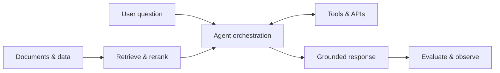

# Hi, I'm Mahan Dehghani 👋

### Computer Science undergraduate · Junior AI Software Engineer

**Building at the intersection of retrieval, agents, and large language models.**

---

## About me

I'm **Mahan Dehghani**, a bachelor's student in **Computer Science at K. N. Toosi University of Technology (KNTU)**.

I build production-ready applications at the intersection of **Retrieval-Augmented Generation (RAG)** and **agentic AI**, with a broader focus on applications powered by large language models. I enjoy connecting models to useful knowledge, tools, and reliable software systems.

My research interests lie at the intersection of **bioinformatics and LLM interpretability**: understanding how language models represent and reason about biological information.

## What I build

- **RAG applications:** document ingestion, chunking, embeddings, vector search, hybrid retrieval, reranking, and answers grounded in cited sources.
- **Agentic workflows:** tool calling, structured outputs, stateful orchestration, memory, and human-in-the-loop interactions.
- **LLM-powered products:** conversational assistants, knowledge search, and APIs that connect models to application data and tools.
- **Production foundations:** asynchronous APIs, input validation, automated tests, containerized deployment, evaluation, tracing, and attention to latency and cost.

## Technology landscape

Tools and technologies relevant to my focus as a junior AI software engineer. This is a map of the ecosystem I work in and continue to explore, rather than a claim of equal expertise in every tool.

### LLM applications & agents

### Retrieval & data

### Serving, evaluation & delivery

### Research toolkit

Beyond frameworks, I focus on **prompt design, tokenization, embeddings, context management, semantic search, BM25, reranking, JSON Schema, REST APIs, SQL, Linux, and CI/CD**. For model adaptation and serving, the ecosystem also includes **PEFT/LoRA, quantization, and vLLM**.

## Research interests 🧬

I'm interested in questions where **bioinformatics meets interpretable language models**:

- How do language models encode biological sequences and scientific knowledge?
- What can probing, attribution, and mechanistic interpretability reveal about their internal representations?
- How can retrieval over biological literature support traceable, evidence-grounded scientific reasoning?
- How can we evaluate biological relevance, uncertainty, and faithfulness in model outputs?

These are research directions I want to explore, not claims of completed projects or published results.

---

**From retrieved knowledge to useful agents — with curiosity about the biology behind the data.**

Animation example from <a href="https://github.com/Platane/snk">Platane/snk</a>; it does not represent my contribution history. Technology badges served by <a href="https://shields.io">Shields.io</a>.

